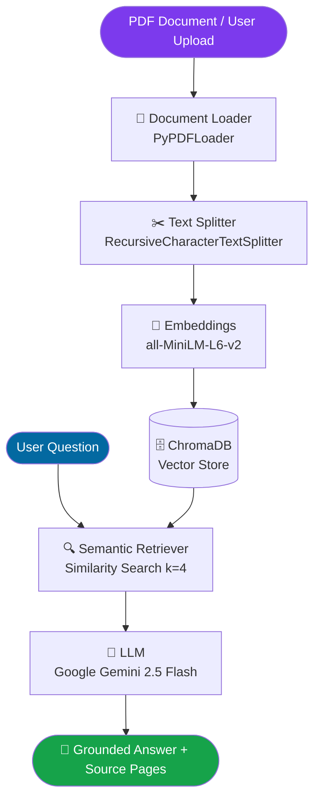

# 📚 Advanced PDF RAG Assistant

[](https://advanced-pdf-rag-assistant.streamlit.app/)
[](https://github.com/RedamJaswanth/Advanced_PDF_RAG_Assistant)

An intelligent Retrieval-Augmented Generation (RAG) assistant that allows users to upload any PDF document or query pre-indexed documents with factual, hallucination-free answers powered by **LangChain**, **Google Gemini 2.5 Flash**, **HuggingFace Embeddings**, and **ChromaDB**.

---

### 🌐 Live Demo
👉 **[Open Live App on Streamlit Community Cloud](https://advanced-pdf-rag-assistant.streamlit.app/)**

---

### 📸 Application Interface

```
+-----------------------------------------------------------------------------------+
|  📚 RAG Assistant         |  📚 Advanced PDF RAG Assistant                        |
|  ------------------------ |  ---------------------------------------------------- |
|  [📄 Upload Custom PDF]   |  Ask intelligent questions about your document...     |
|                           |                                                       |
|  ⚙️ Configuration         |  👤 User: What are the main types of LLM prompting?  |
|  - LLM: Gemini 2.5 Flash  |                                                       |
|  - Vector DB: ChromaDB    |  🤖 Assistant: Based on Page 3, prompting techniques  |
|  - Embeddings: MiniLM-L6  |     include Zero-shot, Few-shot, and Chain-of-Thought.|
|                           |     📌 Sources: [📄 Page 3] [📄 Page 4]              |
|  [🗑️ Clear Chat] [Turns: 1]|     ▶ View Retrieved Context (4 chunks)              |
+-----------------------------------------------------------------------------------+
```
*(Screenshot placeholder: place screenshot at `assets/screenshot.png`)*

---

### ✨ Key Features

- **Interactive PDF Ingestion**: Upload any PDF file dynamically at runtime or use the bundled Generative AI course notes.
- **High-Precision Semantic Retrieval**: Powered by HuggingFace `all-MiniLM-L6-v2` dense embeddings on CPU and ChromaDB vector search.
- **Grounded Answer Synthesis**: Powered by Google's `gemini-2.5-flash` with strict grounding prompts to eliminate hallucinations.
- **Traceable Source Attributions**: Every response cites exact page numbers alongside expandable raw text chunks for transparency.
- **Multi-turn Contextual Memory**: Retains conversation history for intelligent follow-ups.

---

### 🏗️ Architecture



---

### 🛠️ Technology Stack

| Component | Technology |
|---|---|
| **Frontend UI** | Streamlit |
| **LLM Inference** | Google Gemini 2.5 Flash (`langchain-google-genai`) |
| **Vector Database** | ChromaDB |
| **Embeddings** | HuggingFace `sentence-transformers/all-MiniLM-L6-v2` |
| **Orchestration** | LangChain Core / Community |
| **Document Processing** | PyPDF |

---

### ⚡ How to Run Locally

One-line run command:
```bash
pip install -r requirements.txt && streamlit run app.py
```

> **Note**: Set `GEMINI_API_KEY="your_api_key"` in a `.env` file or export it in your terminal before launching.

---

### ☁️ Cloud Deployment (Streamlit Community Cloud)

1. Fork or push this repository to GitHub.
2. Sign in to [Streamlit Community Cloud](https://share.streamlit.io).
3. Click **New app**, select repository `RedamJaswanth/Advanced_PDF_RAG_Assistant`, branch `master`, and main file `app.py`.
4. In **Advanced settings > Secrets**, add:
   ```toml
   GEMINI_API_KEY = "your-google-gemini-api-key"
   ```
5. Click **Deploy!**
