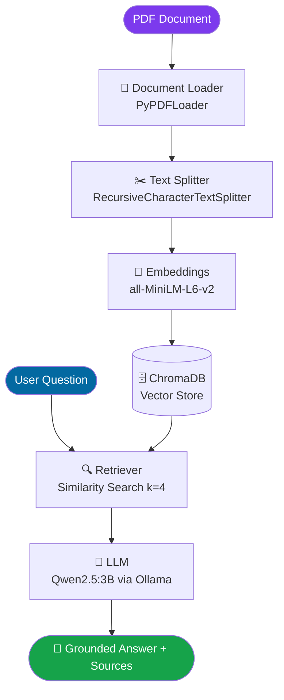

# 📚 Advanced PDF RAG Assistant

A fully **local** Retrieval-Augmented Generation (RAG) system that lets you have intelligent conversations with any PDF document — powered by **ChromaDB**, **Ollama**, **HuggingFace Embeddings**, and **Streamlit**. No cloud API required. Your data stays on your machine.

---

## ✨ Key Features

- **100% local** — all inference runs on your machine, no API keys needed
- **Semantic search** — HuggingFace `all-MiniLM-L6-v2` embeddings with ChromaDB
- **Multi-turn memory** — conversation history passed to the LLM for follow-up questions
- **Source tracing** — every answer shows the exact page numbers it came from
- **Expandable context** — inspect the raw retrieved chunks directly in the UI
- **Clean chat UI** — built with Streamlit, dark-themed sidebar, source chips

---

## 🏗️ Architecture



---

## 🛠️ Technology Stack

| Component | Technology |
|-----------|-----------|
| Frontend | Streamlit |
| PDF Loader | LangChain PyPDFLoader |
| Text Splitter | RecursiveCharacterTextSplitter |
| Embeddings | HuggingFace `all-MiniLM-L6-v2` |
| Vector Store | ChromaDB (local, persisted) |
| Language Model | Qwen2.5:3B via Ollama |
| Framework | LangChain |

---

## 📁 Project Structure

```
Advanced_PDF_RAG_Assistant/
├── app.py                    # Streamlit UI
├── requirements.txt          # Python dependencies
├── .env.example              # Environment template
├── .gitignore
├── README.md
├── data/
│   └── pdfs/
│       └── your_document.pdf # ← Place your PDF here
├── chroma_db/                # Auto-created vector store (gitignored)
└── src/
    ├── __init__.py
    ├── document_loader.py    # PDF loading & chunking
    ├── embeddings.py         # HuggingFace embedding model
    ├── llm.py                # Ollama LLM setup
    ├── vector_store.py       # ChromaDB creation & retriever
    └── rag_pipeline.py       # End-to-end pipeline orchestration
```

---

## ⚙️ Installation (Windows PowerShell)

### 1. Install Ollama

Download from → **https://ollama.com/download**

Then pull the model:
```powershell
ollama pull qwen2.5:3b
```

Start the Ollama server:
```powershell
ollama serve
```

### 2. Clone / navigate to the project

```powershell
cd "d:\VS Code Work\Advanced_PDF_RAG_Assistant"
```

### 3. Create and activate a virtual environment

```powershell
python -m venv .venv
.venv\Scripts\Activate.ps1
```

### 4. Install Python dependencies

```powershell
pip install -r requirements.txt
```

### 5. Add your PDF

Place your PDF inside `data/pdfs/`. If the filename is different, update `PDF_PATH` in [`src/document_loader.py`](src/document_loader.py).

---

## 🚀 Running the App

```powershell
streamlit run app.py
```

Opens at **http://localhost:8501**

---

## 💡 Example Questions

| Question |
|---------|
| `What is generative AI?` |
| `Summarise the key concepts covered in this document.` |
| `What are the differences between supervised and unsupervised learning?` |
| `Explain how transformers work.` |
| `What are the limitations mentioned in the document?` |

---

## ⚠️ Limitations & Future Improvements

### Current Limitations
- Only one PDF at a time (hardcoded path)
- ChromaDB is rebuilt on every cold start (no incremental indexing)
- Local Ollama model quality depends on available hardware

### Future Improvements
- [ ] Support multiple PDF upload via the UI
- [ ] Persistent ChromaDB with incremental indexing (skip re-embedding unchanged docs)
- [ ] MMR (Maximal Marginal Relevance) retrieval to reduce redundancy
- [ ] Swap Ollama for Gemini/OpenAI with a simple config toggle
- [ ] Confidence scoring for retrieved chunks
- [ ] Export conversation as PDF or Markdown
